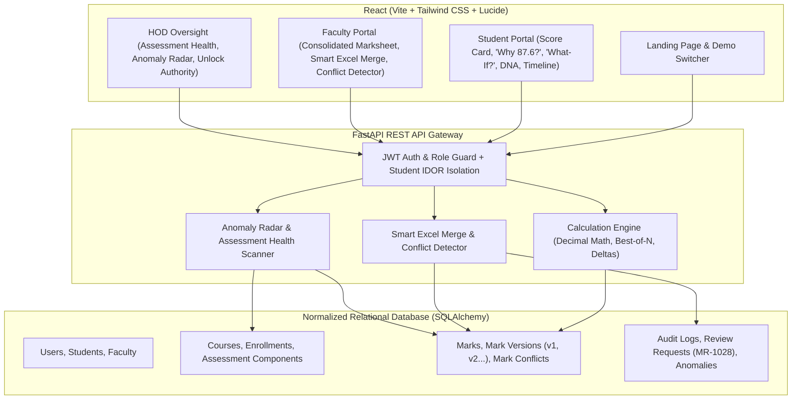

# MARKSCOPE — Every Mark Has A Story
### Explainable Academic Assessment Intelligence Platform for Colleges & Universities

[](https://fastapi.tiangolo.com/)
[](https://react.dev/)
[](https://tailwindcss.com/)
[](https://www.sqlalchemy.org/)
[](https://pandas.pydata.org/)
[](#-automated-testing)

---

## 🎯 What the Application Does

In standard academic institutions, internal marks (tests, assignments, lab work, quizzes, attendance) remain scattered across disparate Excel files stored on individual faculty computers. Manually merging them at semester end frequently leads to:
1. **Calculation drift & rounding errors** across complex weightages
2. **Version confusion & accidental overwrites**
3. **Disputes between students and faculty** due to opaque final numbers
4. **Lack of auditability** when scores are adjusted or re-evaluated

**MARKSCOPE** is an EdTech SaaS platform designed to eliminate manual spreadsheet chaos through:
- **Explainable Calculation Engine (“WHY 87.6?”)**: Breaks down any final internal score into its raw score, percentage, component weightage, and past adjustments.
- **“What-If?” Mark Simulator**: Real-time slider simulator for students to project hypothetical scores without altering official institutional records.
- **MarkScope Audit Timeline**: Git-like visual history tracking every upload, score edit, review ticket, and locking event.
- **Institutional Anomaly Radar**: Automated scanning for data inconsistencies, missing marks, score jumps, identical clusters, and weightage mismatches using neutral QA terminology.
- **Smart Excel Merge & Conflict Detector**: Intelligently identifies student ID and score headers regardless of naming variations and flags conflicting scores for faculty review before importing.
- **Mark DNA Profile**: Constructive, non-competitive score composition analysis highlighting strongest areas, largest point contributions, and improvement headroom.
- **Role-Based Access Control**: Strict permissions and backend IDOR isolation ensuring students can only access their own records.
- **Mark Locking & HOD Oversight**: Course status workflow ($\text{DRAFT} \rightarrow \text{MARKS ENTERED} \rightarrow \text{VALIDATED} \rightarrow \text{SUBMITTED} \rightarrow \text{LOCKED}$) where only the HOD can authorize unlocking.

---

## 🏛️ System Architecture



---

## ⚙️ Environment Variables

Copy the example environment files before running the project:

### Backend Environment Variables (`backend/.env`)

| Variable | Description | Default / Example Value |
| :--- | :--- | :--- |
| `DATABASE_URL` | SQLAlchemy connection string (SQLite or PostgreSQL) | `sqlite:///./markscope.db` |
| `JWT_SECRET` | Strong secret key for signing JWT tokens | Configured via environment (never commit secrets) |
| `HOST` | Backend server binding host | `0.0.0.0` |
| `PORT` | Backend server port | `8000` |

### Frontend Environment Variables (`frontend/.env`)

| Variable | Description | Default / Example Value |
| :--- | :--- | :--- |
| `VITE_API_URL` | Base URL of the running FastAPI backend | `http://localhost:8000` |

---

## 🚀 Setup & Local Execution

### Prerequisites
- **Python**: 3.10+ (Python 3.11 recommended)
- **Node.js**: 18+ (Node 20 or 24 recommended)
- **Package Managers**: `pip` (or `uv`), `npm`

---

### 1. Backend Setup

```bash
# Navigate to backend directory
cd backend

# Create Python virtual environment
python -m venv .venv

# Activate virtual environment
# On Windows (PowerShell):
.venv\Scripts\Activate.ps1
# On Windows (Command Prompt):
# .venv\Scripts\activate.bat
# On macOS / Linux:
# source .venv/bin/activate

# Install dependencies
pip install -r requirements.txt

# (Optional) Create .env from template
cp .env.example .env
```

#### Run the Backend Server:
```bash
# Start FastAPI backend with Uvicorn
uvicorn app.main:app --host 0.0.0.0 --port 8000 --reload
```
The backend will automatically initialize and seed the demo database upon first startup.
- **REST API URL**: `http://localhost:8000`
- **Interactive Swagger Docs**: `http://localhost:8000/docs`

---

### 2. Frontend Setup

```bash
# Open a new terminal and navigate to frontend directory
cd frontend

# Install npm dependencies
npm install

# (Optional) Create .env from template
cp .env.example .env

# Start development server
npm run dev
```
- **Web Application URL**: `http://localhost:5173`

---

## 🧪 Automated Testing

All core mathematical calculations, Best-of-N rules, column recognition heuristics, role permissions, and student IDOR isolation are verified via automated unit tests:

```bash
cd backend
python -m pytest -o pythonpath=. -v
```

### Verified Test Cases:
1. `test_round_decimal_accuracy`: Verifies zero floating-point arithmetic drift
2. `test_weighted_calculation_engine`: Validates exact formula: $42/50 \times 40 + 18/20 \times 20 + 27/30 \times 40 = 87.6$
3. `test_best_of_n_engine`: Validates Best 2 of 3 rule (scores 44 and 39 counted, 35 excluded)
4. `test_smart_merge_column_detection`: Validates dynamic recognition of `Roll No`, `USN`, `Enrollment Number`
5. `test_student_data_isolation`: Verifies IDOR protection (Student A blocked from Student B with `403 Forbidden`)
6. `test_course_locking_restriction`: Verifies faculty cannot edit locked marksheets (`400 Bad Request`)
7. `test_course_weightage_100_validation`: Verifies courses with weightages $\neq 100\%$ are rejected

---

## 👥 Demo Personas (Pre-Seeded Accounts)

You can switch between any of these roles with a single click using the **"Switch Persona"** dropdown in the top navbar:

| Persona | Role | Username | Password | Key Demonstration Focus |
| :--- | :---: | :---: | :---: | :--- |
| **Dr. Arvind Sharma** | `HOD` | `hod` | `hod123` | Institutional Health, Anomaly Radar, Course Unlock Authority, Global Audit Log |
| **Prof. Rajesh Kumar** | `FACULTY` | `faculty1` | `faculty123` | Data Structures (CS201), Smart Excel Merge, Conflict Resolution, Marksheet Export |
| **Prof. Sneha Patel** | `FACULTY` | `faculty2` | `faculty123` | Programming in C (CS101 - **Locked Course** demonstration) |
| **Aarav Sharma (A101)** | `STUDENT` | `student_a101` | `student123` | **Official Score: 87.6/100**, "WHY 87.6?", "What-If" Simulator, Mark DNA, Timeline |
| **Ananya Iyer (A102)** | `STUDENT` | `student_a102` | `student123` | Demonstrates pending conflicting record ($40.0$ vs $46.5$) from `Test_Final.xlsx` |
| **Priya Nair (A104)** | `STUDENT` | `student_a104` | `student123` | Active Review Dispute Ticket `#MR-1028` under review |

---

## 📁 Sample Spreadsheets For Testing

Sample spreadsheets are located in `sample_files/` and can also be downloaded directly via the in-app **"Sample Files"** navbar button:
1. `CS201_Test1_Marks.xlsx`: Clean test spreadsheet with headers `Roll No` and `Test Score`.
2. `CS201_Test1_Re-evaluated_Conflict.xlsx`: Contains a conflicting mark ($46.5$ vs official $40.0$) for student `A102` to test the Conflict Detector.
3. `CS201_Assignments.xlsx`: Demonstrates alternate headers `Enrollment Number` and `Assignment Score` with student `A105` missing a score.
4. `CS201_Lab.xlsx`: Demonstrates university `USN` headers `USN` and `Lab Marks`.
5. `Anomalous_Test_Data.xlsx`: Demonstrates marks $> \text{max}$ ($55/50$) and unknown student IDs to test Anomaly Radar.

---

## 📂 Project Directory Structure

```text
markscope/
├── .gitignore                      # Git ignore rules for Python, Node, envs & DBs
├── README.md                       # Complete platform documentation
├── backend/                        # FastAPI REST API Backend
│   ├── .env.example                # Example backend environment variables
│   ├── requirements.txt            # Python dependencies (fastapi, sqlalchemy, etc.)
│   ├── generate_sample_files.py    # Script generating sample Excel workbooks
│   ├── app/
│   │   ├── __init__.py
│   │   ├── main.py                 # FastAPI application & router mounting
│   │   ├── database.py             # SQLAlchemy session & SQLite/PostgreSQL engine
│   │   ├── models.py               # Normalized relational entities
│   │   ├── schemas.py              # Pydantic v2 validation models
│   │   ├── auth.py                 # JWT token management & IDOR security guards
│   │   ├── calculation_engine.py   # Decimal arithmetic, Best-of-N & Mark DNA
│   │   ├── smart_merge.py          # Flexible Excel column detection & merge
│   │   ├── anomaly_detector.py     # Assessment health & anomaly scanning
│   │   ├── seed.py                 # Realistic academic seed data
│   │   └── routers/
│   │       ├── auth_routes.py      # Authentication & persona switching
│   │       ├── course_routes.py    # Course management, locking & unlocking
│   │       ├── marks_routes.py     # Consolidated marksheets & exports
│   │       ├── student_routes.py   # Student portal & IDOR-isolated endpoints
│   │       ├── excel_routes.py     # Spreadsheet preview, merge & conflicts
│   │       ├── analytics_routes.py # Institutional health & anomaly radar
│   │       └── dispute_routes.py   # Student review tickets (#MR-1028)
│   └── tests/
│       └── test_markscope.py       # Automated unit test suite (7 tests)
├── frontend/                       # React + Vite Frontend
│   ├── .env.example                # Example frontend environment variables
│   ├── package.json                # Frontend dependencies & scripts
│   ├── vite.config.js              # Vite bundler configuration
│   ├── tailwind.config.js          # Tailwind CSS styling tokens
│   ├── postcss.config.js           # PostCSS configuration
│   ├── index.html                  # HTML entry point with Inter font
│   └── src/
│       ├── main.jsx                # React DOM entry point
│       ├── App.jsx                 # App root & role-based dashboard router
│       ├── index.css               # Global CSS & Tailwind directives
│       ├── api.js                  # Centralized API service client
│       └── components/
│           ├── Navbar.jsx          # Top bar, role badge, persona switcher
│           ├── LandingPage.jsx     # Modern SaaS landing page with 3 pillars
│           ├── StudentDashboard.jsx# Score card, 'Why 87.6?', 'What-If?', DNA
│           ├── FacultyDashboard.jsx# Marksheet, manual entry, Excel import, diff
│           ├── HODDashboard.jsx    # Assessment health, Anomaly Radar, unlock
│           ├── DemoTourBanner.jsx  # 10-step guided walkthrough banner
│           └── SampleFilesModal.jsx# In-app test spreadsheets downloader
└── sample_files/                   # Test spreadsheets for upload demonstration
    ├── CS201_Test1_Marks.xlsx
    ├── CS201_Test1_Re-evaluated_Conflict.xlsx
    ├── CS201_Assignments.xlsx
    ├── CS201_Lab.xlsx
    └── Anomalous_Test_Data.xlsx
```
